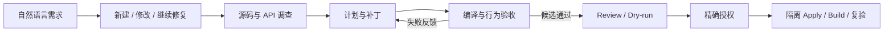

<div align="center">
  
  <p><strong>面向本地和异构模型、以源码证据和真实测试约束交付的 Coding Agent 评测与执行平台</strong></p>
  <p>An evaluation and execution platform for local and heterogeneous coding models, grounding delivery in repository evidence and real tests.</p>
  <p>
    <a href="https://github.com/yang-hoo-xin/RepoForge/actions/workflows/ci.yml"></a>
    
    
    
    
  </p>
  <p>
    <a href="#快速开始">快速开始</a> ·
    <a href="#核心模块与工程取舍">核心模块</a> ·
    <a href="#精简-trace-示例">Trace 示例</a> ·
    <a href="docs/PUBLIC_RESULTS.md">实测结果</a> ·
    <a href="docs/ARCHITECTURE_OVERVIEW.md">架构文档</a> ·
    <a href="deployment/service/README.md">服务部署</a>
  </p>
</div>

---

RepoForge 面向本地和异构模型，将自然语言代码任务的**源码调查 → 补丁生成 → 编译与行为验收 → 授权交付**连接为可追溯工作流。当前已验证案例覆盖普通 SDK-style C# 仓库和可插拔领域验收；具体案例与适用边界在实测结果中单独说明，不把单一领域冒充通用能力。

## 核心能力

- **从当前源码找到依据**：默认使用 ripgrep 活源检索，结合依赖 API、文档 RAG 与引用，为需求调查、规划和代码修改提供上下文。
- **让验收反馈驱动修订**：LangGraph 编排任务阶段，共享 Patch worker 接入真实编译与领域行为验收；失败反馈进入后续修订，候选可保存、复验和续接。
- **让修改和结果可复查**：检查具体补丁、源码版本、授权和测试结果是否对应；产物存储组件（ArtifactStore）保存文件版本及来源关系，运行追踪（Trace）记录模型调用、工具结果和用量。
- **把 Agent 接入服务**：FastAPI 与独立 Worker 复用正常业务入口；Redis 提供队列、租约、幂等、限流和缓存，配合超时处理、Prometheus 与 Docker Compose。

## 工作流



**LangGraph** 负责工作流编排，**RAG / 当前源码检索**提供调查依据，**ArtifactStore**保存产物版本及来源关系，**任务专用测试程序**检查具体工程的编译和行为。模型服务支持本地 Ollama 与配置的外部提供方；执行范围见[产品目标与执行约束](docs/ACTIVE_PRODUCT_CONTRACT.md)，正在进行的工作见[项目进度](docs/PROJECT_STATE.md)。

## 核心模块与工程取舍

RepoForge 按“编排—证据—检索—生成—执行—验收—服务化”拆分职责；各模块通过显式产物与身份关联协作，领域规则与共享 Agent 控制面保持分离。

| 模块 | 职责与关键设计 | 代码 / 证据入口 |
| --- | --- | --- |
| **任务编排与状态机** | 将自然语言请求路由为新建、修改、续接或澄清任务；LangGraph 通过显式状态转移串联调查、计划、补丁、验收与失败修订，并支持 checkpoint、interrupt / resume。 | [请求路由](scripts/dsh_request_routing.py) · [工作流](src/mod_agent/workflow/graph.py) · [规划](src/mod_agent/planning/) |
| **源码检索与上下文管理** | 默认用 `rg` 检索当前工作区，并限制读取范围；检查源码版本是否最新、是否覆盖需求、是否在允许修改的目录中。历史记忆和文档只作辅助，不能替代当前源码。 | [源码调查模块](src/mod_agent/evidence/) · [源码检索](src/mod_agent/evidence/rg_live.py) · [上下文策略](src/mod_agent/evidence/small_project_context.py) |
| **RAG 知识检索** | 摄取链覆盖解析、切分、Embedding、BM25 与向量入库；查询层提供 Sparse / Dense / Hybrid、融合、重排和引用。Dense、RRF 与模型重排保持可选或实验定位，不冒充 Agent 默认取证路径。 | [Ingestion](src/ingestion/) · [Query Engine](src/core/query_engine/) · [检索决策](docs/RETRIEVAL_ARCHITECTURE_DECISIONS.md) |
| **补丁生成与受控执行** | Patch worker 在计划绑定的源码范围内生成最小变更；Review、Dry-run、源码 preimage、允许路径和授权共同约束副作用，再进入隔离 Apply / Build，行为失败可返回 Repair。 | [Patch loop](src/mod_agent/proposal/patch_agent_loop.py) · [受控执行](src/mod_agent/execution/) · [产品执行](src/mod_agent/product_execution.py) |
| **领域验收与评测驱动** | 共享执行链接入编译检查和领域行为裁判，保留首个失败并把可操作反馈送回修订；结果区分 `code_ready`、`awaiting_approval` 与 `delivered`，不以局部通过替代交付。 | [领域验收](src/mod_agent/domain/) · [评测](src/mod_agent/evaluation/) · [EDD 口径](docs/EVALUATION_DRIVEN_DEVELOPMENT.md) |
| **模型接入与训练实验** | 统一 LLM 抽象接入 Ollama、OpenAI、Azure 与 DeepSeek；Agent-turn 另提供 Ollama Chat、Qwen Chat 与 OpenAI Responses 适配器。QLoRA Patch SFT 与 Self-RAG 作为实验链保留，未因脚本存在而进入默认产品路径。 | [模型适配](src/libs/llm/) · [QLoRA SFT](scripts/run_patch_sft_training.py) · [Self-RAG](scripts/run_self_rag_training.py) |
| **产物版本管理、运行追踪与任务恢复** | ArtifactStore 保存文件版本、哈希和来源关系；Trace 记录模型请求、工具结果、Token、测试及失败反馈。任务可以使用已保存补丁继续验证，并沿用原预算恢复；监控界面不能替代原始执行结果。 | [产物存储](src/mod_agent/artifacts/) · [运行追踪](src/core/trace/) · [可观测性](src/observability/) |
| **服务化与协议接入** | FastAPI、独立 Worker 与 Redis 实现异步队列、租约、幂等、限流、缓存和超时；Prometheus、Docker Compose 与 MCP 复用同一业务模块，而不是另写展示逻辑。 | [服务层](src/service_layer/) · [MCP](src/mcp_server/) · [部署指南](deployment/service/README.md) |

## 精简 Trace 示例

下面是 SpreadAPI 受控交付的公开投影，不是伪造的原始日志；本机路径、模型正文和敏感配置被省略，阶段结果仍绑定已记录的 Artifact 与验收身份。

```json
{
  "request": "非法数值输入原子拒绝，并保持状态与回调行为",
  "route": "modify_project",
  "baseline": {"behavior_checks": "53/87"},
  "stages": [
    {"stage": "evidence_retrieval", "status": "passed", "output": "evidence_pack"},
    {"stage": "implementation_plan", "status": "passed", "output": "source-bound plan"},
    {"stage": "patch_proposal", "status": "passed", "output": "exact diff"},
    {"stage": "candidate_verification", "status": "passed", "behavior_checks": "87/87"},
    {"stage": "task_delegation", "status": "approved", "binding": "diff + source snapshot + required checks + allowed effects"},
    {"stage": "isolated_apply_and_build", "status": "passed"},
    {"stage": "final_revalidation", "status": "passed", "behavior_checks": "87/87"}
  ],
  "result": "delivered",
  "scope": "候选与最终 DLL 各 9 个独立进程、60 个动作；跳过游戏回调主体；未启动游戏、未部署"
}
```

完整实验条件、Token 与边界见 [SpreadAPI 受控代码交付](docs/PUBLIC_RESULTS.md#34-spreadapi-受控代码交付)；本地记录可通过 [Trace 查询入口](scripts/product_trace.py)按明确 run 身份读取。

## 已验证成果

| 方向 | 已记录结果 | 验证范围 |
| --- | --- | --- |
| **代码修改交付** | SpreadAPI 候选与正式 DLL 均通过 **87/87** 检查，并完成精确授权的 Apply / Build。 | 已暴露开发题的受控行为验收：9 个独立进程、60 个动作；跳过游戏回调主体。 |
| **工程评测与修复** | 覆盖 **13 个模块、224 个不同工程用例**，最新结果 **222 通过**；定位并修复预算数值与验收产物身份绑定缺陷。 | 部分路径使用替身；其余 2 项训练依赖问题仍在迭代，工程用例数不等于用户任务数。 |
| **服务故障恢复** | **11 项故障联调检查通过**，覆盖 Redis 中断与恢复、Worker 死亡后的租约接管、短预算超时。 | 实际服务进程联调；执行结果不明的 Agent 任务保留为 `indeterminate`，避免盲目重跑。 |
| **异步检索性能** | 4 并发下 **64/64** 作业成功，**1.028 作业/秒，P95 4.031 秒**。 | 两个 Worker、6 个源码文件 / 37 块，单次纯 BM25 检索压测、模型调用 0；非完整 Agent 吞吐。 |

真实 Agent HTTP 入口也已接通 Qwen3-coder:30b 与 LangGraph：候选编译成功，**15/15 受控行为断言**通过，停在 `awaiting_approval`；尚未 Apply，完整交付仍在迭代。完整数据、成本、实验条件和历史结果见[公开实测记录](docs/PUBLIC_RESULTS.md)。

## 快速开始

### 本机体验

环境：Python 3.10+、`uv`；源码调查使用 `rg`。以下命令验证入口并生成只读工程导航，不调用模型：

```powershell
git clone https://github.com/yang-hoo-xin/RepoForge.git
cd RepoForge
uv sync --frozen --extra dev
uv run --frozen python -m src.main --help
uv run --frozen python -m scripts.engineering_cognition --view summary --pretty
uv run --frozen pytest tests/unit/test_mod_agent_cli.py -q
```

完整 Coding Agent 运行通过任务 profile 配置目标工程、模型服务、适用的 .NET / 领域依赖，以及写入和 Build 范围，参见[Agent 注册](deployment/service/README.md#agent-注册)。

### v0.1 正常入口演示

安装 .NET 8 SDK 后，下面的确定性演示通过真实公共 CLI 执行源码调查、首次错误候选、真实失败测试、当前代码读取与修订、精确 Apply、Build 和最终复验：

```powershell
uv run --frozen python -m scripts.run_v0_1_demo --output artifacts/v0_1_demo
```

演示使用脚本模型与脚本审批，不需要模型凭据，也不作为自主模型修复成绩；其中源码副本、`.NET` 编译、失败/通过行为测试、Apply/Build 恢复和最终结果读取均走产品正常入口。正式发布检查会在干净提交上追加 `--require-clean`。Windows工作区路径较长时，可用`--workspace-parent <已有短路径目录>`指定临时构建父目录。为什么要有它：外部用户需要可复现完整接线，同时必须知道哪些部分是真实执行、哪些部分只是确定性替身。

已有 SDK-style C# 仓库也可从同一入口使用 `mod-agent run-request --repository-profile <配置文件>`，并沿用目标工程、模型和隔离执行选项。配置明确 SDK、项目或 solution、允许修改的源码、测试项目、测试命令／报告和预期工件；格式与完整使用流程见[真实双项目 CLI 验收](tests/unit/test_csharp_repository_product_entry.py)及其[配置示例](tests/unit/test_csharp_repository_backend.py)。当前支持 TRX 或明确的 JSON 断言报告，不自动替任意仓库推断构建方式。

候选和正式交付使用同一套构建／测试；`apply-patch --resume-approval` 后，`apply-patch --continue-build --allow-build` 从原检查点恢复配置，无需另写较弱的 BuildProfile。该通路已用真实 SDK 验证失败、修订、复验及恢复交付；验收中的模型与审批为测试脚本，不作为模型自主修复成绩。原工程不被修改，构建在本地工作副本内执行，并非操作系统安全沙箱。

连续任务 Agent 的 **v2 协议正在集成验证，尚非默认**。在上述显式 C# 仓库配置、本地 Ollama、隔离构建及延期审批入口上，使用 `--technical-executor task_agent --task-agent-protocol v2`。模型可以先调查，再在已授权文件范围内选择修改目标、修订当前候选和选择公开测试；技术计划不授予权限。经验通过可选的 `--task-agent-experience-config` 接入，临时探针没有合格隔离执行环境时不可运行。完整范围和当前缺口见[实施设计](docs/AGENT_RELIABILITY_LEARNING_GOAL.md)及[项目进度](docs/PROJECT_STATE.md)。为什么要有它：新能力的可选入口、默认状态和实际验证范围需要同时说明，不能把开发中的接口当成已证实的自主交付能力。

v2 中断任务使用 `mod-agent run-request --resume-task-agent <原检查点引用> --artifact-store-root <原工件目录>`，沿用原配置、权限与累计资源，不附加新任务参数。候选接管后的 `awaiting_delivery` 仍非交付：使用输出的 `v2_delivery_checkpoint_ref`，经 `apply-patch --v2-delivery-checkpoint <引用> --v2-delivery-action prepare|apply|build` 分别准备精确审批、执行 Apply 和构建；各阶段使用返回的当前引用及适用的批准参数，不能混用 v1 恢复参数。完整调用示例见[正常 CLI 回归](tests/unit/test_task_agent_v2_product_entry.py)。为什么要有它：恢复必须继续同一任务，交付必须绑定实际候选和批准，不能靠重新运行领取新预算或沿用旧检查。

经验对照可在现有经验配置中提供可选 `trial_binding_ref`，绑定已冻结协议、任务、尝试及 B／B+ 组别；宿主会在首次模型调用前保存这一关联。已结束运行可通过 `mod-agent export-strategy-execution --execution-record <原execution.json> --call-id <实际调用ID> --output-root <新目录>` 导出供评测核验的原生证据，预登记信息从原配置派生。缺少前置关联的历史运行只能作为诊断材料，仍保留未知成本；该命令不运行模型或评测题。为什么要有它：模型真正看到了什么、执行了什么以及比较条件是否预先固定，需要从正常入口的原件判断。

可选的完整工程探针通过仓库配置中的 `probe_runner` 接入：`kind=docker_sdk_project_v1`，指定已在本机可用的官方 SDK 镜像 digest、准确 `sdk_version`、`target_framework` 和被引用的 `.csproj` 路径；需要依赖包时指定离线 `.nupkg` 目录及其清单哈希。平台生成引用所选候选工程的探针项目，分别在受限构建和运行容器中执行，不接受模型提交工程脚本。宿主资格检查未通过时返回能力不可用，不下载镜像、不启动 Docker Desktop、不回退到宿主执行。当前只有受控边界与接入验证，实际 Docker 隔离资格仍待环境成立；它不是独立业务验收。配置字段和受控示例见[探针执行器测试](tests/unit/test_repository_probe_runner.py)。为什么要有它：完整依赖工程的实验、模型自建探针与正式验收用途不同，未验证的执行环境不能被接口存在掩盖。

v2 的候选编辑可以直接提供路径和当前源码视图，由平台在同一事务内核验授权与精确前像并建立 binding；技术计划和单独绑定调用不是编辑前置。当前工作状态保留实际模型陈述、公开观察和失败，历史按模型容量投影，原文仍可按引用读取。恢复继续核验来源、未决操作及累计资源。这些通路已有正常入口与边界验证，但不代表模型一定会据此采取有效行动。为什么要有它：用户应知道工具能执行什么，以及哪些模型效果仍未获证明。

从源码检出目录可通过 `python -m scripts.extract_strategy_experience prepare|preview|execute` 消费显式登记的公开经历输入；先准备冻结集合和零模型容量预检，再按已登记条件执行一次提炼。输入示例与失败处理见[入口测试](tests/unit/test_extract_strategy_experience.py)，数据来源、动作顺序和省略范围见[过程投影测试](tests/unit/test_process_trajectory.py)。这不自动读取任意历史目录，也不自动启用生成的策略。最近一次五来源真实提炼返回证据不足；最新真实修复仍无候选，详见[结果与限制](docs/evidence/continuous-repair-20261025.json)。为什么要有它：真实消费入口、数据使用范围和实验结果需要一起说明，不能把提炼接口存在当作学习有效。

### Docker 服务演示

环境：Docker Engine / Docker Desktop 与 Compose。将 [`.env.example`](deployment/service/.env.example) 复制为 `deployment/service/.env`，设置两个不同的随机值：`SERVICE_API_TOKEN` 和 `SERVICE_REDIS_PASSWORD`；保留已有配置，凭据不提交 Git。为什么要有它：接口和队列使用独立凭据，公开仓库只保存可共享的模板。

```powershell
docker compose --env-file deployment/service/.env -f deployment/service/compose.yaml up -d --build --scale worker=2
curl.exe http://127.0.0.1:8080/health
```

Compose 自动初始化真实仓库源码的 BM25 / Chroma 示例语料，默认运行无需模型的纯检索服务。API 文档位于 `http://127.0.0.1:8080/docs`，Prometheus 位于 `http://127.0.0.1:9095`。请求格式、认证、Agent profile 注册和停止命令见[部署指南](deployment/service/README.md)。

## 深入阅读

| 从这里开始 | 内容 |
| --- | --- |
| [公开实测结果](docs/PUBLIC_RESULTS.md) | 交付案例、服务性能、故障恢复与证据范围。 |
| [架构说明](docs/ARCHITECTURE_OVERVIEW.md) · [产品契约](docs/ACTIVE_PRODUCT_CONTRACT.md) | 模块职责、执行流程与权限边界。 |
| [部署指南](deployment/service/README.md) · [压测说明](scripts/service_load/README.md) | API / Worker / Redis / Prometheus 部署与测量口径。 |
| [测试](tests/) · [评测定义](docs/EVALUATION_DRIVEN_DEVELOPMENT.md) · [历史成果](docs/PROJECT_OUTCOMES.md) | 回归检查、评测方法与完整演进记录。 |
| [v0.1.0 发布目标](docs/V0_1_RELEASE_GOAL.md) · [候选版本说明](docs/releases/v0.1.0.md) · [Changelog](CHANGELOG.md) | 首版范围、发布门禁、已知限制与版本变化。 |

## 持续迭代

RepoForge 正在围绕更多独立工程任务、重复交付稳定性、训练依赖收口和服务长期运行验证持续迭代；游戏运行时与跨环境支持按具体领域任务扩展。当前发布面向本机研发与受控验证，模型质量、性能优化和成本收益以对应实验为依据，进展记录在[项目状态](docs/PROJECT_STATE.md)。

维护者负责需求定义、架构与技术选型、验收设计，并结合 AI 编码工具推进实现；平台开发、产品模型行为和独立评测分别记录。
