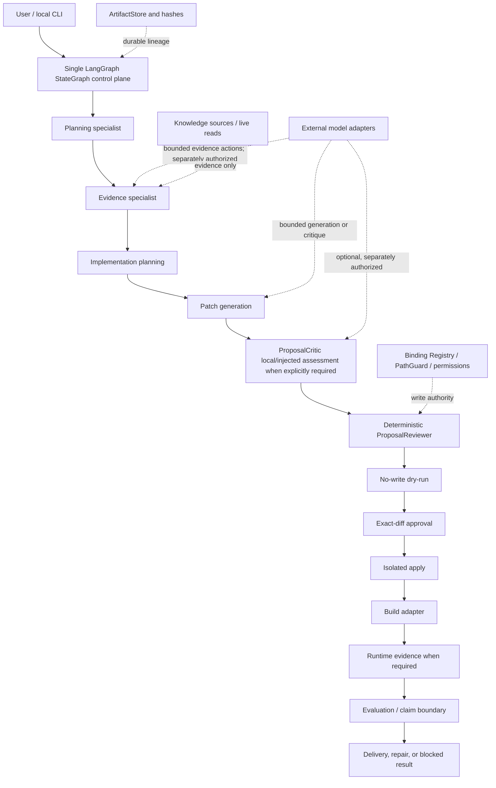
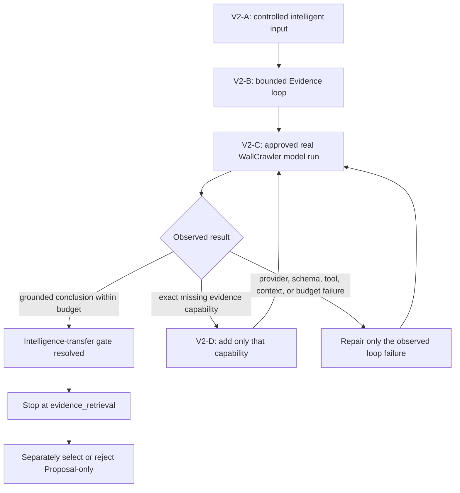
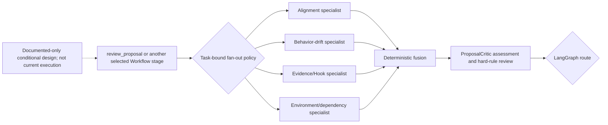
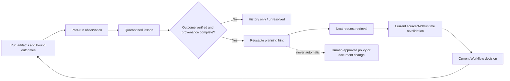

# Architecture Overview

Status: current architecture orientation

This document explains the active product shape, the verified implementation
boundary, and the rules that prevent architectural drift. It does not replace
`docs/ACTIVE_PRODUCT_CONTRACT.md`, `DEV_SPEC.md`, or the artifact contracts.

## 1. Product Boundary

This repository is an evaluation and execution platform for local and
heterogeneous coding models, grounding delivery in repository evidence and real
tests. Verified cases currently include ordinary SDK-style C# repositories and
pluggable domain-specific acceptance adapters. Individual domains are recorded
with their evidence and limitations instead of defining the whole product or
proving arbitrary-repository support. The product is the controlled delivery
chain, not a general-purpose RAG system, an autonomous multi-agent framework,
or a benchmark-only platform.

```text
request
-> acceptance and verification boundary
-> current source/API evidence
-> bounded implementation bindings
-> generated proposal
-> explicitly configured ProposalCritic assessment when required
-> mandatory deterministic review
-> no-write dry-run
-> exact-diff approval
-> isolated apply
-> real build
-> required runtime/evaluation, repair, or explicit blocked result
-> truthful delivery claim
```

### 1.1 Current Integration Target: Coding Agent v0

The current product milestone is Coding Agent v0, with
`docs/CODING_AGENT_V0_INTERNAL_ALPHA.md` defining its first integrated
delivery. This target composes the modules shown below; it does not replace the
single LangGraph control plane or add another Agent SDK.

The model-facing loop is observation-driven:

```text
understand request
-> choose one bounded read-only investigation
-> receive source/tool observation
-> revise the engineering direction or stop
-> produce evidence-bound implementation work
-> receive Build/Test observation
-> revise once or finish
```

LangGraph owns allowed execution order, permissions, interruption, recovery,
and terminal routing. It must not hard-code BetterHitFeedback methods,
WallCrawler gaps, search direction, or the semantic response to a Build/Test
failure. Domain-specific rules remain behind Domain Harness or calibration
boundaries.

The first committed BetterHitFeedback EvidencePack is consumed internally by
Planning/Patch/Build before public entry adoption. BetterHitFeedback and
WallCrawler Hidden-Golden plus minimal Eval then close RAG-1A. RAG-1B makes the
same Evidence executor available through the unique public Agent entry and
forms Coding Agent v0 public alpha.

## 2. Current Control-Plane Architecture



LangGraph owns execution order, conditional routing, interrupt/resume, and
checkpoint integration. ArtifactStore owns durable business outputs and audit
lineage. Deterministic policies retain authority over write scope, approval,
verification, and claim promotion.

### 2.1 Bounded Build-To-Runtime Continuation

The same control plane now has one durable cross-process boundary after a
successful real Build. `WorkflowCheckpointStore` persists the Build state and
exact Artifact lineage through `workflow_checkpoint`; `ResumeValidator` binds
the original run, request, feature, intended Runtime entry, fresh side-effect
admission, and `resume_report`. `ArtifactStore` provides immutable revision
reads, recursive freshness, physical Build-byte verification inputs, and
durable consumed-resume lookup. The `resume-runtime` entry reacquires current
GTFO capability, launch, and game-directory-write authority and then compiles
the existing graph with its start routed to `collect_runtime_evidence`.

Real run `e7daa266` exercised this boundary with the current GTFO provider.
Fresh-process resume retained the original run/request/feature and Build
Artifact hash, performed no model call or upstream-stage repetition, deployed
and hash-verified the exact DLL, collected trusted startup-marker evidence,
completed Eval and WorkflowSummary, and restored the destination. This is
real-execution evidence for the bounded H1.1 path, not a general persistence or
Runtime-provider claim.

This boundary does not add a second workflow or lifecycle store. It does not
make the in-memory LangGraph checkpointer persistent, resume arbitrary nodes,
recover an interrupted external side effect, or guarantee concurrent
exactly-once consumption. Runtime attempt journaling and arbitrary-crash
recovery remain outside H1.1.

### 2.2 Runtime Failure Ownership And Repair Routing

Current maturity: `implemented` for the bounded H3 Runtime failure path.

RuntimeEvidence now carries a normalized `failure_ownership` decision with an
owner, failure class, required action, and deterministic
`source_repair_allowed` value. The provider-neutral owners are product
behavior, observation, environment, provider, permission, and unknown.
Verified acceptance records no failure owner. Missing, malformed, or historical
ownerless evidence normalizes to unknown and cannot authorize source repair.

The existing `RepairPlanner`, `repair_plan`, conditional routes, and blocked
terminal remain the only repair control path. Product behavior may re-enter
Proposal/Review only when current evidence resolves to an allowed edit binding.
Observation, environment, provider, permission, and unknown outcomes generate
owner-specific blockers, preserve the source-repair retry count, and do not
repeat Proposal, Dry-run, Apply, or Build. GTFO maps its current admission,
environment, launch, log, screenshot, and observation stages into this
contract; GTFO does not choose the LangGraph route or authorize source edits.

#### 2.2.1 Bounded Edit Authority Request And Approval

The Stagger Runtime failure activates one product-bounded authority repair.
Technical diagnosis, current source identity, exact edit span, proposed
operation, and projected identifiers live in `edit_authority_request`. That
Artifact exact-binds its four business inputs and explicitly grants no
authority. `edit_authority_approval` is the only forward authority source. It
contains only the exact Request and ResumeReport revisions, request hash,
human decision identity, allowed projection actions, and forbidden later
actions.

The public CLI can create the Request but cannot create the Approval.
LangGraph owns the human interrupt/resume and validates the exact request hash
before the Approval can be persisted. ArtifactStore then requires exact
Request and ResumeReport upstreams and rejects new writes using the historical
combined Approval payload. Current revision selection compares both revision
path and complete Artifact hash. EvidencePack, ImplementationPlan, and
BindingResolution remain deterministic projections; they are not independent
authority sources. A partial projection is observable as an accepted approval
without a matching final BindingResolution and remains blocked. This path does
not add two-phase commit, automatic authorization, a second graph, or a
general-purpose contract engine.

The supported local review entry is a transport into this gate, not an
Approval producer. It receives a separately reviewed exact Request hash,
invokes the existing graph to expose one interrupt, and resumes that same
in-process graph. The Graph and ArtifactStore remain the only writers.
`check_exact_revision_freshness` validates the immutable revision subgraph
without requiring historical upstreams to remain latest; separate
current-revision admission still requires the selected revision hash to equal
the latest projection and its path to exist in immutable revision storage.

Real shared-Store integration exposed a bounded two-Plan lineage case: the
current Plan is a historical authority projection, while the current
PatchProposal binds its predecessor Plan. The existing-binding
reauthorization entry represents those roles explicitly and preserves the
already materialized `edit_binding_004`; it does not rewrite history, create a
duplicate binding, or claim a direct PatchProposal-to-current-Plan edge.
Its Request grants no authority. A permission-only Approval still requires the
existing LangGraph interrupt/resume gate, and the resulting new
BindingResolution must exact-bind the previous Resolution and all business
inputs. This is a product-bounded continuation path, not a general
ratification engine.

The checkpoint for that gate directly binds the Request, not a flattened copy
of its historical exact-role subgraph. This preserves one owner for role and
freshness semantics: the latest Request is a normal checkpoint input, while
the Request's registered upstream edges retain exact-revision behavior.
Flattening those refs would incorrectly reinterpret predecessor artifacts as
latest-bound inputs. The original Edit Authority Request schema retains its
existing expanded checkpoint projection; no generic checkpoint protocol or
ArtifactStore behavior changed.

Repair-plan source selection uses the current failing graph stage. A stale
Build or Runtime summary from an earlier attempt cannot override a later
ProposalReview failure. This adds no exception hierarchy, repair controller,
provider registry, or second StateGraph. Automatic Runtime retry, semantic
root-cause inference, side-effect recovery, and cross-provider execution proof
remain outside this boundary.

Real run `06c09532` exercised this H3 route through the current GTFO provider.
The RuntimeEvidence owner was `observation`; RepairPlan emitted
`RUNTIME_OBSERVATION_REPAIR_REQUIRED`, preserved `retry_count=0`, authorized no
source change or next stage, and reached the existing blocked terminal without
a resume-stage model call or another Proposal, Dry-run, Apply, or Build
revision. Deployment hash binding and restoration passed. This real routing
evidence does not prove semantic root-cause accuracy: the intended absent
marker was not the only missing fact because the current-run log window also
lacked `Chainloader` and the product marker.

Post-fix real run `95efb988` exercised the repaired observation boundary under
the same H3 route. Current-run generation 2 bound `BepInEx`, `Chainloader`, and
`chain_probe=true` to exact source windows while only the deliberately absent
marker remained missing. The graph again emitted
`RUNTIME_OBSERVATION_REPAIR_REQUIRED`, authorized no source repair, repeated no
upstream stage, and restored the exact deployed DLL. This real-exercises the
bounded multi-generation negative path; it does not add automatic retry,
semantic diagnosis, another provider, or generalized Harness behavior.

### 2.3 Bound ProposalReview Project Context

Current maturity: `implemented` for explicit, read-only ProposalReview context
on a materialized domain project.

`DomainReviewPolicy` retains the GameProfile status, allowed roots, forbidden
paths, and project root. A caller may bind one exact domain target root so that
project-relative Proposal paths are reviewed as root-qualified domain paths.
The bound target root must itself pass the existing policy. Root-qualified
paths for another project, traversal, forbidden paths, and absolute paths
outside the bound materialized project remain blocked.

`build_graph(domain_review_policy=...)` supplies this policy only to the
existing `review_proposal` node. It is mutually exclusive with an explicitly
supplied DomainAdapter registry, adds no graph node or route, and does not
authorize Dry-run or writes. Default graph construction continues to resolve
DomainPolicy through the existing registry.

Run `sfp_qwen3_4b_002_rereview_001` bound an exact hash-validated materialized
GTFO project plus target root `generated_mods/BetterHitFeedback`, reused the
existing PatchProposal, and produced an approving ProposalReview with zero
model calls and no upstream repetition. It stopped before Dry-run. This proves
the bounded review-context path, not generic workspace remapping or broader
DomainAdapter onboarding.

Run `sfp_qwen3_4b_002_dry_run_001` reused that exact Proposal/Review lineage
and resumed the same graph boundary into the existing `dry_run_apply` node.
`ExactTextPatchApplier` performed one in-memory exact-text replacement,
persisted the structured before/after hashes and exact diff hash, and the graph
interrupted immediately after Dry-run. Source bytes were unchanged and no
later Artifact was created. This is execution evidence for the existing
no-write boundary; it adds no node, route, provider, or write authority.

After the user supplied that exact hash, run
`sfp_qwen3_4b_002_isolated_apply_001` resumed the same graph after
`dry_run_apply`, used the existing `isolated_apply` node, and atomically wrote
only the approved bytes inside the run-local materialization. The resulting
Artifact binds Proposal, Review, Dry-run, approval hash, before/after source
hashes, and the one changed path. The graph interrupted before Build. This is
execution evidence for the existing approval/write boundary, not a new control
plane or authority to Build or run the product.

### 2.4 Complete Proposal Admission And Preapproval Diff

Current maturity: `implemented` for exact Implementation Plan coverage,
binding-local exact-text source, and pre-write diff/static-check preparation.

The selected stagger failure proved that validating only the changes returned
by a Generator is insufficient. Patch Generation now receives a compact list
of required Plan change units and must return the exact
`(change_id, edit_binding_id)` set. Each `before_text` must come from the
evidence bound to that edit binding. ProposalReviewer independently repeats
both checks; a legal subset or a cross-binding source excerpt cannot reach
Dry-run.

`ExactTextPatchApplier` retains the existing no-write/write split. Before any
approval or write it now validates each exact replacement against the binding's
registered target span, stages the complete result in memory, emits a unified
diff with raw SHA256 and line statistics, and runs a low-cost lexical C#
delimiter check. The check intentionally does not claim symbol, type, overload,
or complete control-flow validation. The CLI displays the unified diff,
statistics, and checks before requesting the existing exact diff approval.
On the human-review branch, semantic approval follows inspectable bytes and precedes
isolated Apply and Build.

Run `sfp_manual_repair_005` exercised this boundary without a model or source
write. Its Proposal covers all three selected Plan units, deterministic Review
returned `approve_dry_run`, and its one-file preapproval diff passed three
target-span checks plus lexical delimiter balance. This is bounded Proposal
admission and reviewability evidence; it is not compilation, semantic approval,
Apply, or Runtime evidence.

### 2.5 V2 Intelligence Experiment And Productization Boundary

The control-plane diagram above is the implemented delivery baseline. It is not
yet evidence of one canonical V2 runtime path. The diagram below records the
V2-C experimental intelligence-loop structure and its failure-driven repair
history; it is not the current product mainline or a continuing work list.



V2-A excludes exact symbols, DLL choice, tool sequence, Hook, precomputed IL
reports, and artificial blockers from an acceptance run. V2-B may reason and
use registered read-only tools, but it cannot choose graph routes, authorize
paths or writes, approve a Proposal, or launch execution stages. V2-C may
truthfully finish with grounded `needs_more_evidence`; Proposal remains locked.
V2-D activates only from an exact observed failure and never authorizes a
general decompiler, generic ReAct platform, new retrieval stack, multi-agent
swarm, or long-term memory system.

V2-C is now frozen as a `V2 intelligence-loop validation spike`. The repaired
real run proves one observation-dependent loop closure and leaves capability,
semantic, readiness, and convergence verdicts independent. It does not prove
that this entry is the Agent's authoritative runtime, that one state owner
exists, that retry/stop/completion ownership is unified, or that the source
baseline is reconstructable. `source_binding_status=missing` remains binding.

Before another gameplay capability or conditional delivery gate is selected,
the repository must reconstruct one actual run's control path, intelligent
execution path, and evidence path from readable source and runtime evidence.
That read-only reconstruction is a pending task type only; no task id or queue
entry exists before Source Registry, trace/EvidencePack, file-scope,
authorization, and no-write acceptance checks.

The current mapping is: deterministic WallCrawler work through
`WALLCRAWLER-CURRENT-HOOK-EVIDENCE-003` established the request/source/tool
baseline; `WALLCRAWLER-INTELLIGENT-EVIDENCE-004` implemented V2-A/V2-B and its
first real Qwen attempt exposed the failure; acceptance hardening plus
`WALLCRAWLER-INTELLIGENT-EVIDENCE-005` repaired the provider, context,
observation, and acceptance boundaries locally.
`WALLCRAWLER-INTELLIGENT-EVIDENCE-006` then exercised the new interface with
real Qwen. Compact observations worked, but the model used all six tool calls
for metadata search, performed no IL inspection, and returned two invalid
finish shapes. This activates only the documented trigger for a bounded
model-facing finish-schema and acceptance-progress repair.
`WALLCRAWLER-INTELLIGENT-EVIDENCE-007` completed that repair locally by sharing
one exact nested schema across response format, system context, and correction
feedback, and by exposing current metadata/IL acceptance progress. It did not
change tools, budgets, graph authority, or the evidence-only stop. At that
historical checkpoint, real-model acceptance remained unresolved.

`WALLCRAWLER-INTELLIGENT-EVIDENCE-008` executed that rerun once. The structured
finish and acceptance-progress repair changed the failure boundary: real Qwen
now converged, selected a metadata-derived IL read, and returned a valid finish.
The remaining structural loss occurs when the full IL observation is no longer
the latest observation. `_compact_step` preserves metadata rows under
`observed_methods`, but IL observations store `method_id`, `symbol`,
`metadata_token`, and instruction facts as direct fields; the compact IL step
therefore exposes `observed_methods: []`. The final conclusion treated that as
an unsuccessful IL read and did not cite the IL observation. This activated
only the compact-IL representation and inspection-citation repair completed as
009; it did not authorize more tools, budget, graph authority, Proposal, or
another external run.

`WALLCRAWLER-INTELLIGENT-EVIDENCE-009` completed that repair locally. Compact
reconstruction now separates deduplicated metadata method identities from
direct IL inspection outcomes, excludes the current latest full observation
from both catalogs, and records serialized discovery-message bytes per turn.
Deterministic finish validation requires an observed/inferred conclusion to
cite an available IL observation and offers one bounded correction. Post-IL
state recommends finishing unless one exact unresolved gap justifies another
tool call, so `needs_more_evidence` does not require broad metadata expansion.
This changes only the Evidence specialist context representation and stop
signaling; the tools, production budgets, graph authority, and evidence-only
boundary were unchanged. At that historical checkpoint, real-model acceptance
remained unresolved.

Section 51 retains deeper conditional gates for evidence-to-implementation
planning, Proposal-only generation and review, deterministic dry-run and
approval, build-failure repair, runtime diagnosis, and delivery evaluation.
They remain inactive until the runtime-path reconstruction identifies the
authoritative entry, run state, loop position, action/verification boundary,
retry owner, stop owner, completion owner, and Artifact owner. They are not a
preactivated consecutive queue.

The local `plan-request` command is a bounded entry slice before this full
graph. It runs RequestPlanner and ModPlanningBriefBuilder in memory, emits both
planning payloads, and stops before `feature_spec` without ArtifactStore writes.
Hook-required planning-only requests report `needs_evidence` and hand off to
Hook discovery; this entry does not retrieve source evidence or enter proposal,
apply, build, or runtime stages.

The `evidence-request` entry uses that same graph with the explicit
`stop_after_evidence` route. It reads only the approved GTFO R8 manifest,
validates exact file hashes, symbols, and JSON identity linkage, persists the
normal planning and evidence artifacts, and maps both evidence outcomes to
`END`. It does not create a second workflow or grant implementation authority.

The bounded R8 IL inspector uses .NET `PEReader` and CLI metadata without
loading or executing the target assembly. Its exact JSON report is hash-bound
and validated before three IL EvidenceItems enter the existing evidence node.
It is a task-specific evidence reader, not a general decompiler service or a
new routing authority.

For the current WallCrawler follow-up, the same deterministic reader accepts
only an explicitly supplied assembly path and an exact symbol set selected by
the Evidence specialist. It rereads the assembly hash before and after
inspection and records current interop or reference-Mod items in the normal
EvidencePack. It is not a separate Agent and is not a RAG authority: retrieval
may later find its recorded facts, but cannot replace live hash and metadata
validation.

The current Evidence specialist also has one implemented bounded internal
loop. It is not a second graph and does not own routing:

```text
natural-language evidence goal + path-hidden registered source views
-> provider-neutral Agent turn returns one native tool call or final JSON object
-> deterministic source/tool/argument/budget validation
-> local read-only metadata observation
-> model selects an observed method_id
-> deterministic exact IL read and identity revalidation
-> model emits observation-bound findings and unresolved questions
-> deterministic EvidencePack serialization
-> LangGraph stop, continue, or blocked route
```

The long-lived source layer remains `SourceDefinition` / Source Registry. For
this loop its metadata projection uses these exact fields:

```json
{
  "evidence_discovery_kind": "unity_script_assembly",
  "evidence_class": "supplied_r8_unity_export",
  "description": "R8 Modules assembly supplied by the user.",
  "allowed_tools": ["search_dotnet_metadata", "inspect_method_il"],
  "assembly_relative_paths": ["Modules-ASM.dll"],
  "version_identity": {"game_release": "R8"}
}
```

`root_path` stays in the machine-local registry and is never included in the
model view. The single-run input is the request plus budgets and stop boundary.
The model cannot supply an absolute path or exact symbol to the IL tool; it must
use a current-run `method_id` bound to source id, relative path, assembly hash,
MVID, metadata token, and exact observed symbol. External chat execution
requires a one-run disclosure record covering the request, path-hidden source
views, and metadata/IL observations. Injected local tests require no external
disclosure and are labelled as such in EvidencePack provenance.

The implemented model boundary is not `BaseLLM.chat()` widened with
provider-specific fields. Plain chat remains intact. The adjacent structured
Agent-turn contract represents messages, exact tool JSON Schemas, tool call ids,
parsed arguments, bound tool results, final response schema, stop reason,
provider/model/request identity, and normalized token usage. Two provider wire
mappings are locally tested:

- `QwenChatAgentAdapter` uses OpenAI-compatible Chat Completions native tools,
  disables thinking and parallel calls for this dependent evidence sequence,
  and uses documented JSON-object mode for a forced final turn. Qwen's wire
  response is still subject to all local deterministic validators; no provider
  strict-schema equivalence is assumed.
- `OpenAIResponsesAgentAdapter` maps typed input/output items, exact
  `function_call` / `function_call_output` linkage, returned reasoning items,
  strict `text.format`, incomplete/status reason, and usage. It is an adapter
  inside the Evidence specialist, not a second orchestrator or durable state
  owner.

The local Artifact/trajectory remains authoritative. Provider continuation is
used only to bind the immediately preceding tool call to its output; the
platform does not treat provider-side conversation state or
`previous_response_id` as workflow memory.

Final conclusions use one exact classification: `observed`, `inferred`, or
`unknown`. The validator requires current-run observation refs for observed and
inferred claims, limitations for inferred claims, and no observation refs for
unknown claims. The durable audit projection stores sanitized action JSON and
hashes, observation hashes and byte counts, prompt-contract and initial-context
hashes, model identity, and budget consumption. It intentionally does not store
the raw prompt or expose machine-local roots.

Each turn is reconstructed rather than appended to an unbounded chat history:

```text
immutable initial goal and path-hidden source views
+ compact prior action/observation summaries and observed method ids
+ latest full observation only
+ current budget or correction state
```

Earlier full observations remain in the EvidencePack audit trace but are not
replayed cumulatively. Metadata search requires `result_kinds` and
`limit_per_kind`; its model projection factors assembly SHA256/MVID into one
assembly table and carries per-kind matched/returned/truncated counts. The
default local cap is 50 results per requested kind and 16 KiB per metadata model
observation.

The ignored machine-local registry contains two task-relevant exact sources
rather than unrelated directory noise:
the supplied R8 `Modules-ASM.dll` and current installed interop
`Modules-ASM.dll`. Their registered SHA256/MVID values are checked against the
live metadata report on every search. This local registry is execution input,
not a committed cross-machine configuration or a new retrieval subsystem.

The prior approved Qwen run is retained as failure evidence: it exhausted 8
model steps and 6 tool calls after 205,912 observation bytes and produced no
conclusion. It triggered compact context reconstruction, focused metadata
results, native structured turns, and stricter trajectory acceptance. It did
not prove semantic discovery quality, and rerunning Qwen requires a new per-run
disclosure approval.

The provider-neutral Agent-turn boundary now has a loopback-only Ollama adapter
in addition to the fixture-tested hosted adapters. This is not a second control
plane: it only maps native tool calls, tool results, structured finish output,
and local usage into the existing Evidence specialist. Local execution accepts
only literal `127.0.0.1` or `::1` HTTP origins, does not follow redirects or
inherit proxy routing, and is recorded as `local_agent_turn_adapter`.

011 exercised that adapter with a real local `qwen3:4b-instruct` model. The
control and data-locality boundaries passed, but the model repeated
identifier-ineffective natural-language metadata queries, selected no IL, and
failed the separate capability, convergence, and semantic gates. This is a
recorded product failure, not authority to add a provider router, larger budget,
new evidence tool, or Proposal stage.

### 2.6 Two Cognition Systems And Regenerable Views

Codex engineering cognition and product Dependency/API Evidence are separate
systems. The former helps Codex navigate and change this platform repository;
the latter helps the product Agent understand a target Mod, game, dependency,
API usage, and behavior well enough to ground implementation. Engineering
orientation is not product evidence, and product relevance is not repository
or write authority.

`python -m scripts.engineering_cognition --view summary --pretty` projects
current source, Git, registries, tests, Artifact metadata, and available
receipts into a bounded read-only orientation. Its query vocabulary is
Entry/Surface, Workflow/Route, Artifact DAG, Ownership/Authority,
Source/Dependency, API Usage, Behavior/Dataflow, and Verification/Claim. These
are eight on-demand projections, not eight stored knowledge graphs or state
stores. State/field producer-consumer facts are cross-cutting projections
inside Workflow/Route and Ownership/Authority, not a ninth state machine. The
default `summary` view is intentionally thin; deeper views run only for the
selected question.

The projection distinguishes source declarations, current observations,
executed verification, stale context, and unknowns while retaining source
references. Those distinctions describe evidence and freshness, not
authority. Static reachability cannot establish semantic ownership, a correct
modification target, or proof that an Actual ran. Actual history is reported
only to the exact boundary supported by available structured run records. A
task packet whose Git/task identity no longer matches is stale context only.

The projection writes no product Artifact and adds no LangGraph node,
cognition database, shadow registry, or route authority. The single existing
LangGraph remains the workflow control plane; current contracts, explicit
owners and Binding/Review rules retain their execution responsibilities.
Apply consumes a bound human decision or the limited host-issued
`task_delegation_decision_v1` from `execution/task_delegation.py`.
为什么要有它：closure3已执行任务委托分支，授权来源须与实际接口一致；导航投影仍不授予写权限。

Product Dependency/API Evidence is currently partial. `fresh-coverage` builds
coverage from `RgLiveEvidenceProvider` over live target-workspace `*.cs`
source. The repository separately has bounded assembly metadata/IL discovery
through `LocalAssemblyEvidenceToolExecutor` and optional run-local direct
Boolean member-access enrichment through `RunLocalMemberAccessResolver` in
ProductExecution. Those pieces do not yet form a general documentation or
reference-usage, call/read/write, lifecycle, or behavior-dataflow path into
Fresh -> Planning -> Patch. The API views therefore expose current connection
points and explicit unknowns; they do not claim general API-aware Mod
implementation. Here, API "write" means generated Mod code invoking a mutating
API member; it does not grant Evidence, RAG, or cognition tools filesystem-write
authority.

Current maturity: `implemented` for the tested read-only engineering
projection; `partial` for product Dependency/API Evidence at the exact
boundaries above.

## 3. Workflow, ReAct, And Specialist Roles

The top-level product loop remains a controlled Workflow. This is deliberate:
code modification requires stable permission, evidence, review, approval,
rollback, and claim boundaries.

Specialist roles run inside the single graph. They are not independent workers
with unrestricted tools or separate write authority. A specialist may use a
bounded internal reasoning/tool loop only after a real task demonstrates that a
fixed step is insufficient. Such a loop must have an explicit evidence scope,
tool allow-list, retry budget, stopping rule, and structured output contract.

ReAct is therefore an optional local strategy, not the control plane and not an
active migration target.

### 3.1 Architecture Reference Status

Architecture references in this document use three exact maturity labels:

| Label | Meaning | Effect on implementation work |
| --- | --- | --- |
| `implemented` | Current source contains the behavior and focused evidence supports the stated boundary | May be reused within its recorded claim limits |
| `documented_only` | The design clarifies separation of responsibilities or a possible shape, but the behavior is absent from current source | Must not be claimed, invoked, configured, or treated as a missing active task |
| `conditional_trigger` | The design may enter the queue only after the named product failure or use case is recorded | The trigger authorizes a bounded decision or implementation task, not the entire reference architecture |

`documented_only` and `conditional_trigger` are not synonyms for queued,
planned, required, or partially implemented.

### 3.2 Bounded Specialist Fan-Out

The Workflow may call several same-level read-only specialists when one real
decision contains separable risk dimensions. The fraud-domain labels in the
reference diagram are not copied into this product. For controlled code
delivery, useful dimensions may include:

- requirement and acceptance alignment;
- Hook/API/source-evidence adequacy;
- behavior drift and non-goal preservation;
- environment, dependency, and compatibility risk;
- build/runtime verification adequacy;
- permission, disclosure, and supply-chain boundaries.

Only dimensions relevant to the selected request should run. Do not create an
always-on specialist swarm merely to resemble a multi-agent diagram.



Each specialist receives a bounded context pack containing registered Artifact
refs/hashes and only the evidence excerpts required for its dimension. It must
return a structured assessment with summary, findings, supporting refs,
unknowns, limitations, and a recommended action. A summary alone is not
evidence and cannot support claim promotion. Specialists do not receive file
write, apply, build, approval, route-selection, or unrestricted retrieval
authority.

The fusion policy validates freshness, required dimensions, score ranges,
missing/failed specialists, and contradictions. It may reduce confidence or
route to repair/human clarification, but only LangGraph conditional edges make
the final transition. Parallel execution, timeouts, and partial-result handling
remain unimplemented until a real task justifies them.

Current maturity: `documented_only`.

`conditional_trigger`: a selected product request must contain two or more
separable assessment dimensions whose independent results can materially change
the route, and the existing single review path must have produced or exposed a
specific insufficiency. The trigger permits only the minimum required
specialists and fusion rule.

## 4. ProposalCritic Local/Injected Assessment Boundary

The ProposalCritic local/injected assessment boundary reviews a main-role
judgment without becoming a second controller.
For the patch path, it reads the registered `patch_proposal` and its bound
upstream context, then emits a structured `critic_assessment` containing:

- the exact subject artifact ref and hash;
- dimension scores and total score;
- a pass, revise, block, or unresolved verdict;
- structured findings and limitations;
- an explicit read-only/no-route-authority boundary.

The deterministic review layer fuses this assessment with existing hard rules.
A passing ProposalCritic assessment cannot override missing evidence, an
invalid binding, a forbidden path, missing permission, or a required human
approval. A failing or unresolved ProposalCritic assessment cannot approve a
write. LangGraph conditional edges make the final continue/repair/blocked
transition.

The implemented boundary supports the local deterministic scorer or an injected
scorer. Calling a separate external model is a later adapter choice and
requires the same per-run disclosure and secret-handling rules as other model
calls. Until a real external Critic run is preserved, the project must not claim
that external-model ProposalCritic review has been validated.

This is a specialist provider hosted by
the existing `review_proposal` node. Its result is saved as a separate
`critic_assessment` Artifact, but it does not add a second routing system or an
always-on model call. A separate LangGraph node is justified only if a real use
case later requires independent retry, timeout, or latency routing.

Current maturity: `implemented` for ProposalReviewer hard-rule review plus one
optional ProposalCritic local/injected assessment inside `review_proposal`.

The following two-level review design is `documented_only`:

1. each Worker performs a lightweight structured self-check before returning;
2. same-level Worker outputs are deterministically fused;
3. a second-level ProposalCritic receives the fused judgment and complete
   evidence chain in a separate clean context;
4. the second level performs adversarial review but still has no write,
   approval, or LangGraph route authority.

The current implementation does not provide a universal Worker self-check
contract, parallel Worker scoring, a fusion result, a separate clean-context
second-level Critic, or two-level-review execution evidence.

`conditional_trigger`: a selected real task must show that the implemented
ProposalReviewer plus single ProposalCritic boundary misses a material conflict
because evidence is split across specialist contexts, or that context
isolation/retry/timeout requires a separate review node. One trigger does not
authorize a general multi-agent review platform.

### 4.1 Requirement States And Routes

There is no inferred risk trigger. The graph caller must set the requirement
explicitly.

| State | Meaning | Deterministic route |
| --- | --- | --- |
| `not_required` | `critic_requirement="not_required"`; ProposalCritic is not called and no `critic_assessment` is written | Apply existing ProposalReviewer hard rules; approval continues to dry-run, revision enters repair, other blockers enter blocked |
| `required_succeeded` | `critic_requirement="required"`; the provider returned a structurally valid, current-hash-bound assessment | Pass verdict plus score at least 80 continues through hard rules; revise/low score enters repair; block verdict enters blocked |
| `required_failed` | Required provider is absent, raises, returns unresolved, stale, malformed, wrong-policy, or wrong-hash output | Fail closed to blocked; no dry-run and no implicit retry |

Supplying a provider while the requirement is `not_required` is a configuration
error. This prevents an injected scorer from silently becoming an execution
trigger.

### 4.2 Score Aggregation Policy

Policy version: `proposal_critic_local_injected_v1`.

Applicability: `patch_proposal_review_only`. It does not score retrieval,
runtime acceptance, final task success, or cross-project quality.

Aggregation is `equal_weight_rounded_mean`: evidence grounding, scope
discipline, verification quality, and reversibility each contribute 25 percent;
the rounded arithmetic mean must be at least 80. Passing also requires verdict
`pass`, no blocking ProposalCritic finding, an exact current `patch_proposal`
hash, and a valid read-only authority declaration.

Priority is fixed:

1. ProposalReviewer hard blockers, permissions, binding rules, and human
   approval cannot be overridden by any score.
2. Required ProposalCritic execution/binding/schema failure blocks the path.
3. A valid block verdict blocks; revise or a score below 80 enters repair.
4. Only a valid pass at or above 80 may continue to the remaining hard rules.

The score is a local structural policy, not evidence that semantic correctness,
runtime behavior, or product quality improved.

### 4.3 Business Decision And Action Translation

Current maturity: `implemented` for the existing deterministic Mod-delivery
actions. ProposalReviewer and LangGraph currently translate review facts into
the exact decisions and routes already represented by the workflow, including:

- `approve_dry_run` to no-write dry-run;
- `revise_proposal` to the bounded repair path;
- `blocked_insufficient_evidence`, `blocked_scope_risk`, and
  `blocked_requires_human` to blocked handling;
- exact-diff approval before isolated apply;
- task-specific runtime/evaluation applicability through the acceptance
  boundary.

The fraud-domain four-tier action model (low risk direct release, medium risk
step-up verification, high risk rejection, and grey-zone manual handling) is
`documented_only` as a business-architecture reference. This repository does
not implement a generic configurable risk engine, merchant/amount tiers,
business-loss thresholds, or outcome-driven threshold tuning. ProposalCritic's
80-point patch-review policy is not a general business-risk score.

`conditional_trigger`: a selected product request must require an action that
the existing review/repair/blocked/runtime/evaluation routes cannot express,
and the required action must be derived from that request's real acceptance or
safety boundary. Implement the smallest deterministic action rule; do not add
a generic risk platform merely to mirror the reference model.

### 4.4 Long-Term Experience And Closed-Loop Improvement

Artifact history, checkpoint state, and chat history are not automatically
trusted long-term memory. Closed-loop improvement must preserve the distinction
between an observed run, a reusable lesson, and an approved control rule.



A reusable lesson must bind at least the original request, relevant source and
Artifact hashes, environment/version context, observed failure, action taken,
verification result, limitations, and invalidation conditions. It may help the
next run choose evidence queries, identify risks, preserve non-goals, or propose
tests. It may not authorize a path, Hook, patch, permission, runtime claim, or
delivery decision.

Current source, current API shape, current Binding Registry, current runtime
evidence, and explicit user approval always outrank stored experience. A lesson
whose source/version/environment assumptions no longer match is stale and must
be rejected or revalidated.

The system must not silently rewrite prompts, scoring thresholds, `AGENTS.md`,
SPEC documents, permissions, or routing policy from one outcome. A durable
control-rule change requires explicit human review and a normal code/document
change with tests or recorded rationale. This is governed learning, not
self-modifying behavior.

The current repository has Artifact lineage and planning placeholders for
retrieved experience, but it does not yet implement verified lesson extraction,
experience retrieval, automatic feedback ingestion, or policy learning. Those
capabilities should begin only after repeated real tasks show that manually
recorded lessons are useful and the required provenance can be captured without
building a separate memory platform.

Current maturity is split deliberately:

- `implemented`: immutable run artifacts and hashes, checkpoint/runtime state
  at their existing boundaries, Git history, and `LOOP_HISTORY` as audit
  records. These are stored evidence, not learned memory.
- `documented_only`: verified-lesson quarantine, next-request experience
  retrieval, asynchronous real-outcome feedback ingestion, automatic risk
  profile updates, Recall/Precision feedback, threshold learning, and policy
  learning.
- `conditional_trigger`: repeated verified real tasks must expose the same
  recurrence or retrieval failure, the outcomes must be provenance-bound, and
  manual lessons must be demonstrably insufficient. The first triggered task
  is a bounded lesson-capture/retrieval experiment, not an automatic policy
  updater.

## 5. Architecture Maturity

| Area | Current status | Allowed claim |
| --- | --- | --- |
| Local request entry | Verified for one BetterHitFeedback request-to-real-runtime slice | Local synchronous entry works for the preserved run through approved isolated apply, build, and separately controlled runtime verification |
| LangGraph StateGraph and conditional routing | Tested | One controlled graph owns the implemented route matrix |
| Structured Evidence Agent turns | Qwen Chat and OpenAI Responses request/response mappings locally tested | Provider-neutral tool/final/usage semantics work inside the Evidence specialist; no real-provider semantic-quality claim |
| Artifact lineage and hash binding | Tested on focused paths | Registered outputs retain current upstream refs and hashes |
| Regenerable engineering cognition | Tested read-only projection over current repository facts | Bounded orientation and explicit unknown/stale reporting only; no durable state, product evidence, route, or authority claim |
| Product Dependency/API Evidence | Partial: live target C# retrieval plus separate bounded metadata/IL and direct Boolean member-access paths | No general API documentation, usage, lifecycle, behavior-dataflow, or cross-Mod correctness claim |
| Patch review, no-write dry-run, and exact approval | Verified on the narrow real run plus focused tests | Model output cannot directly authorize a write |
| ProposalCritic local/injected assessment boundary | Tested for explicit not-required, required-success, and required-failure paths | No external-model or semantic-quality-improvement claim |
| Two-level Critic and same-level specialist fan-out | `documented_only`; `conditional_trigger` not satisfied | No Worker self-check, parallel specialist execution, deterministic fusion, clean-context second-level Critic, or two-level-review claim |
| Business decision/action translation | Existing Mod workflow routes `implemented`; generic four-tier risk model `documented_only` | No generic business-risk engine, configurable domain thresholds, or automatic action tuning claim |
| Real build | Verified for the preserved BetterHitFeedback run | The declared DLL compiled for that run |
| Gameplay/runtime acceptance | Verified for the selected BetterHitFeedback `General.Enabled` slice plus one bounded accepted startup-marker slice and one bounded single-missing-marker negative slice in one real GTFO environment | Disabled startup and enabled gameplay behavior are observed for the Phase 2B DLL; `e7daa266` proves accepted automated deployment and terminal closure; `95efb988` proves multi-generation observation retention and observation-owned blocked closure when only the designated marker is absent. No cross-environment, long-duration, every-route, second-profile, automatic retry/recovery, or production-mature Harness claim |
| Bounded Build-stage cross-process continuation | `implemented` and real-exercised | One pre-side-effect local checkpoint resumed into the existing Runtime/Eval/Terminal graph without upstream repetition; no general persistent graph backend, arbitrary-node resume, post-side-effect recovery, or concurrent exactly-once claim |
| MCP/API/webhook/scheduler trigger surfaces | Partial or future-triggered | They are not the current production entry |
| Long-term experience and closed-loop learning | Audit storage `implemented`; learning design `documented_only`; `conditional_trigger` not satisfied | Artifact history is not automatic memory, feedback learning, or policy tuning |
| ReAct/Agentic routing | Deferred | No active architecture migration |

## 6. Change Triggers And Stop Rules

Do not add graph nodes, schemas, model roles, retrieval infrastructure,
dashboards, MCP write routes, or evaluation machinery merely to make the
architecture look complete.

An architectural change requires at least one of:

- a concrete real request cannot complete through the current chain;
- an observed failure cannot be represented or routed truthfully;
- a demonstrated safety or claim defect requires a new gate;
- a selected external user/client requires a missing interface;
- a bounded product decision requires new evidence.

After the smallest verified fix or capability succeeds, stop architecture work
and return to the product request. Workflow maturity is supporting evidence,
not an independent delivery goal.

## 7. Portfolio And Engineering Story

The project demonstrates engineering and design ability through the combination
of a runnable vertical workflow and explicit control boundaries:

- LangGraph state-machine orchestration and deterministic conditional routing;
- evidence provenance, binding identity, hashes, and stale-data checks;
- bounded model authority and read-only ProposalCritic assessment;
- human approval, isolated mutation, rollback, and reproducible build evidence;
- domain adapters separating GTFO behavior from generic platform control;
- truthful separation of tested, compiled, runtime-observed, and accepted claims;
- failure-triggered evolution instead of roadmap-driven infrastructure growth.

The strongest next breadth proof is another concrete Mod capability or delivery
shape that exercises the existing control plane and exposes a real missing
capability.

## 8. Authority Reference

This document does not define an authority or reading order. Follow
the current user request and the applicable working agreements in `AGENTS.md`.
为什么要有它：旧 section 2 已不再定义权限顺序，架构说明不能产生另一套任务授权。
